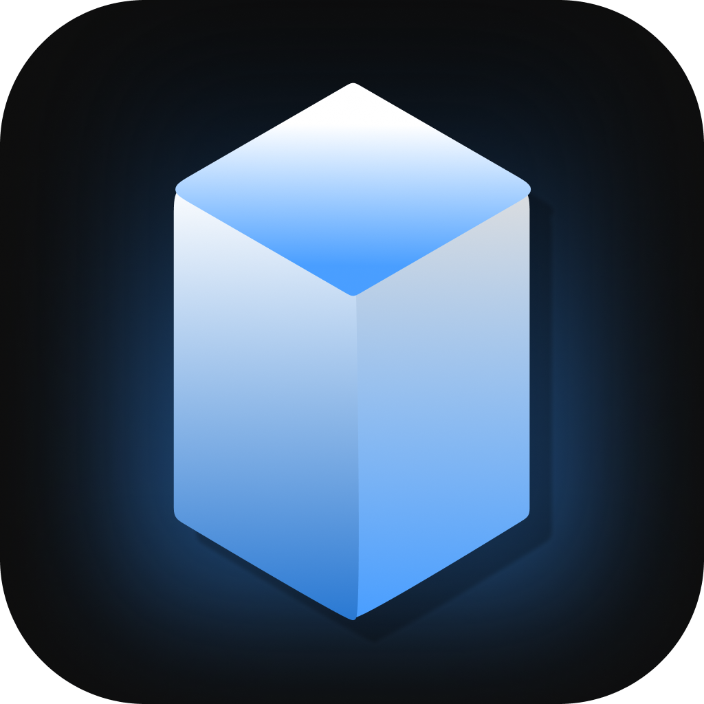
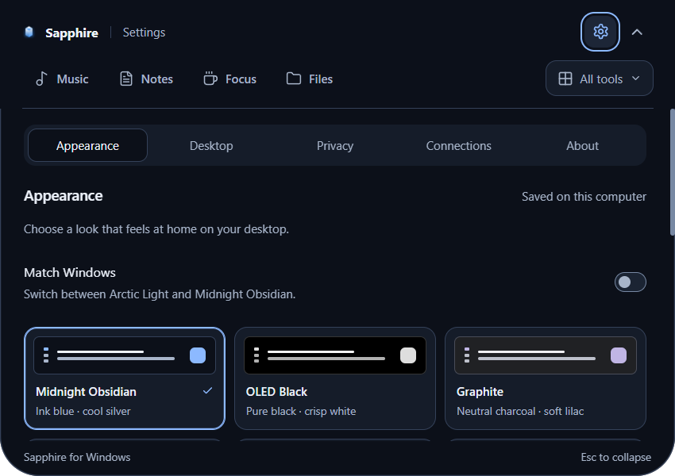
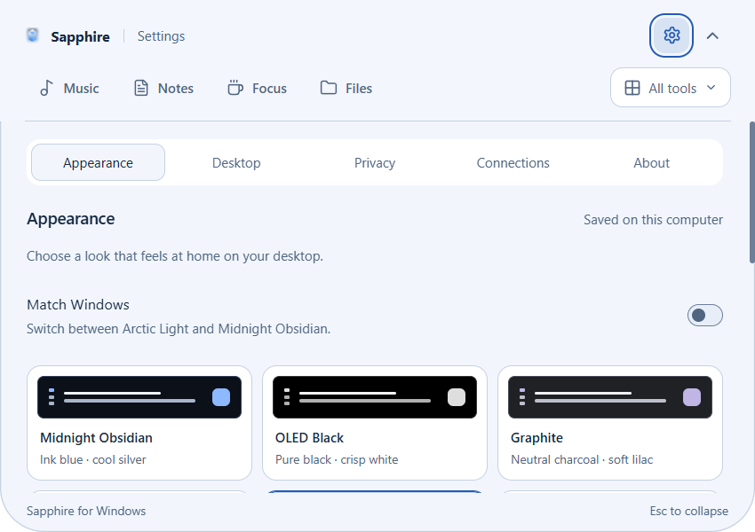

<p align="center"></p>
<h1 align="center">Sapphire for Windows</h1>
<p align="center">Music, notes, focus tools, and everyday controls — one small notch away.</p>
<p align="center">
  <a href="https://github.com/ahmed-progra/sapphire-windows/releases/latest"></a>
  <a href="https://github.com/ahmed-progra/sapphire-windows/actions/workflows/ci.yml"></a>
  <a href="LICENSE"></a>
  
</p>
<p align="center"><a href="https://github.com/ahmed-progra/sapphire-windows/releases/latest"><strong>Download Sapphire</strong></a> · <a href="docs/INSTALL.md">Installation</a> · <a href="docs/FEATURES.md">Features</a> · <a href="CONTRIBUTING.md">Contributing</a></p>

Sapphire is a community Windows adaptation of [Sapphire by Shariq Charolia](https://github.com/cshariq/Sapphire). It brings a compact, expandable productivity panel to the top of your desktop, with a tray menu and configurable keyboard shortcuts. This repository is independent of the upstream author.

## Install

**Windows 11 x64 is recommended.** The minimum native OS target is Windows 10 build 19041; minimum-version and ARM64 compatibility are not qualified. Downloaded builds include the runtime: no Node.js or .NET SDK is needed.

1. Open the [latest release](https://github.com/ahmed-progra/sapphire-windows/releases/latest).
2. Run **`Sapphire-1.2.0-win-x64-Setup.exe`**, or extract the entire ZIP and open `Sapphire.exe`.
3. Sapphire opens with a short appearance introduction. Choose a theme in **Settings → Appearance**. Use **Ctrl+Shift+S** to show/hide it and the tray menu to quit.

The current release is **1.2.0**. Manual launch shows the panel; optional Windows sign-in launch stays quiet. Binaries are **unsigned** and Windows may show an unknown-publisher warning. Verify the release origin and SHA-256 checksum; do not disable Windows security. [Installation, upgrades, and troubleshooting →](docs/INSTALL.md)

## What you get

Labeled Music, Notes, Focus and Files navigation keeps daily tools close. **All tools** groups every other tool; Settings always stays visible.

| Midnight Obsidian | Arctic Light |
| --- | --- |
|  |  |

Settings screenshots captured from the native 1.2.0 desktop app with a disposable profile.

| Everyday tools | Desktop integration | Make it yours |
| --- | --- | --- |
| Local notes with recovery drafts | Windows media-session controls | Ten appearance choices, including custom |
| Opt-in text clipboard history | Per-app audio and output levels | Dark, light, and Windows-matched themes |
| Calendar with `.ics` imports | Eight window snap layouts | Reduced motion and keyboard navigation |
| Focus timers and stay-awake mode | Tray controls and show/hide shortcut | Floating island or notch layout |
| File shelf and weather | Supported battery, brightness, and Bluetooth information | Persistent appearance and window settings |

Optional Spotify, Gemini, finance, and sports integrations require your own configuration and provider access. Hardware-dependent features report unavailable states. [Feature boundaries →](docs/FEATURES.md)

## Privacy and data

Notes and settings stay in your local Windows profile. Clipboard collection starts **off**. Provider credentials use Windows-protected storage and are excluded from ordinary exports. Notes, clipboard history, and exported backups are **not encrypted**. Weather and optional connected services make network requests when used. [Data and privacy →](docs/PRIVACY.md)

## Build from source

Use Windows x64, **Node.js 24.16.0**, and **.NET SDK 10.0.402**. JavaScript dependencies and the alternative native build inputs are pinned.

```powershell
git clone https://github.com/ahmed-progra/sapphire-windows.git
cd sapphire-windows
npm ci
npm run build:native
npm test
npm run build
npm start
```

```powershell
npm run dev                   # Electron + Vite
npm run package:release       # Installer and ZIP in release/
npm run test:desktop:isolated  # Private desktop and separate profile
```

The browser preview (`npm run dev:web`) has limited capabilities; native integrations require Electron. See [CONTRIBUTING.md](CONTRIBUTING.md) for architecture/build details and [verification](docs/VERIFICATION.md) for actual test coverage.

## Project links

- [Report a bug](https://github.com/ahmed-progra/sapphire-windows/issues/new?template=bug_report.yml) · [Request a feature](https://github.com/ahmed-progra/sapphire-windows/issues/new?template=feature_request.yml)
- [Changelog](CHANGELOG.md) · [Security reporting](SECURITY.md) · [Release checklist](docs/RELEASING.md)
- [Native protocol](native/README.md) · [Detailed feature parity](docs/PARITY.md) · [Motion and themes](docs/MOTION-THEMES.md)

## License and attribution

[GNU AGPL v3](LICENSE). Based on [cshariq/Sapphire](https://github.com/cshariq/Sapphire/tree/792f9b4ea3d556d7566fbc38592fe54e88d89dc0), by **Shariq Charolia**. Original branding and assets remain attributed to their owners. This is not an official Windows release from the upstream author. See [NOTICE.md](NOTICE.md) and [dependency notices](native/licenses/README.md).
